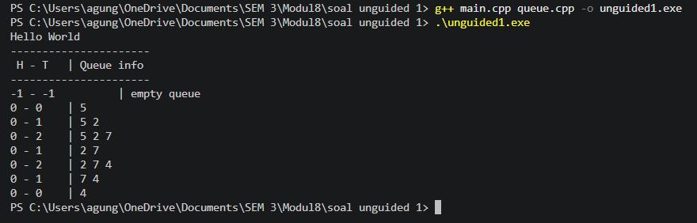
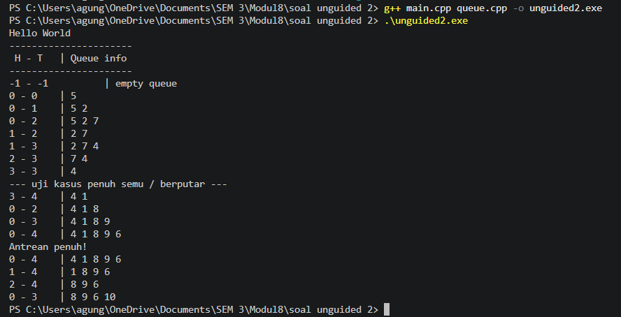
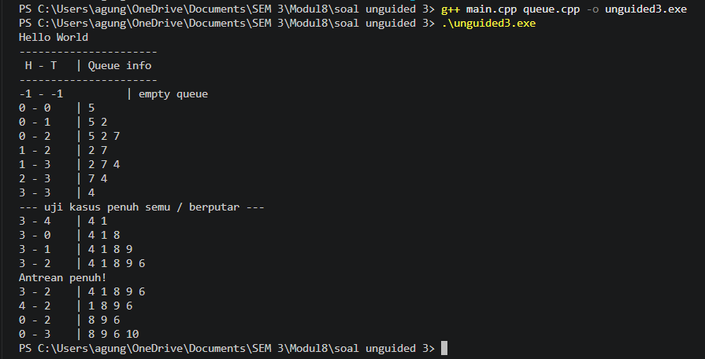

# <h1 align="center">Laporan Praktikum Modul 8 - Queue</h1>
<p align="center">Agung Tri Utomo - 109082500048</p>

## Dasar Teori

### A. Pengertian dan Operasi Queue<br/>
Queue atau antrean adalah struktur data linier yang bekerja dengan prinsip FIFO (*First In First Out*), artinya data yang masuk paling awal akan keluar paling awal [4]. Contoh yang paling mudah adalah antrean nasabah di bank, yang dilayani sesuai urutan kedatangan [1]. Sebuah queue punya dua penunjuk, yaitu *head* untuk elemen paling depan dan *tail* untuk elemen paling belakang. Queue bisa dibuat dengan array maupun *linked list* [4].

#### 1. Enqueue
Enqueue adalah operasi untuk menambah elemen baru ke dalam antrean. Elemen baru selalu diletakkan di belakang, tepat setelah *tail* [4].

#### 2. Dequeue
Dequeue adalah operasi untuk mengambil elemen dari antrean. Elemen yang diambil selalu yang berada paling depan, yaitu elemen yang ditunjuk *head* [4].

#### 3. Penerapan Queue
Queue banyak dipakai pada sistem pelayanan yang harus mengikuti urutan kedatangan. Contohnya sistem antrean online di Puskesmas yang menggantikan antrean manual [3], dan sistem antrean bank yang memakai logika FIFO dengan struktur data *deque* pada Python [1].

### B. Queue dengan Representasi Tabel (Array)<br/>
Kalau queue dibuat dengan array, jumlah elemennya terbatas sebesar ukuran array dan tidak ada pengelolaan memori seperti pada representasi pointer [4]. Pada modul, representasi tabel dibagi menjadi tiga alternatif.

#### 1. Alternatif 1 (head diam, tail bergerak)
*Head* selalu berada di indeks awal, sedangkan *tail* maju setiap ada elemen baru. Saat dequeue, semua elemen digeser ke depan lalu *tail* mundur satu langkah. Cara ini mirip orang yang maju satu langkah ketika antrean berkurang, tetapi kurang efisien karena harus menggeser elemen [4].

#### 2. Alternatif 2 (head bergerak, tail bergerak)
*Head* ikut maju ketika elemen diambil, jadi dequeue tidak perlu menggeser elemen. Kekurangannya, antrean bisa terlihat penuh padahal masih ada ruang kosong di depan karena *tail* sudah sampai indeks terakhir. Kondisi ini disebut penuh semu. Pada saat itu elemen harus digeser dulu, dan pergeseran hanya dilakukan kalau *tail* sudah mencapai indeks maksimum [4].

#### 3. Alternatif 3 (head dan tail berputar)
*Head* dan *tail* berputar mengelilingi indeks array dari awal sampai akhir, lalu kembali ke awal, sehingga tidak perlu ada pergeseran. Cara ini disebut *circular buffer* atau *circular queue* [4]. Pada penelitian sistem antrean pasien, circular queue dipakai karena data yang sudah keluar bisa langsung diganti data baru tanpa menggeser elemen lain, jadi pemakaian memori lebih efisien [2].

## Guided 

### 1. Queue dengan Linked List 

**queue.h**

```C++
/* File : queue.h
   Contoh ADT queue dengan representasi fisik pointer
   Representasi address dengan pointer
   Tipe info adalah integer */

#ifndef QUEUE_H_INCLUDE
#define QUEUE_H_INCLUDE

#include <iostream>
#define Nil NULL

typedef int infotype;
typedef struct elmQ *address;

struct elmQ {
    infotype info;
    address next;
};

/* Deklarasi tipe data queue, terdiri dari head dan tail, 
   queue kosong jika head = Nil */
struct queue {
    address head;
    address tail;
};

/* Prototype */

/********* Pengecekan apakah queue kosong ***********/
bool isEmpty(queue Q);
/* Mengembalikan nilai true jika queue kosong */

/********* Pembuatan queue kosong *********/
void CreateQueue(queue &Q);
/* I.S. sembarang
   F.S. terbentuk queue kosong */

/********* Manajemen memori *********/
address alokasi(infotype X);
/* Mengirimkan address dari alokasi elemen
   Jika alokasi berhasil, maka nilai address tidak Nil
   dan jika gagal, nilai address Nil */

void dealokasi(address P);
/* I.S. P terdefinisi
   F.S. memori yang digunakan P dikembalikan ke sistem */

/********* Pencarian sebuah elemen list *********/
address findElm(queue Q, infotype X);
/* Mencari apakah ada elemen queue dengan P->info = X
   Jika ada, mengembalikan address elemen tsb, dan Nil jika sebaliknya */

bool fFindElm(queue Q, address P);
/* Mencari apakah ada elemen queue dengan alamat P
   Mengembalikan true jika ada dan false jika tidak ada */

/********* Penambahan elemen **********/
void insert(queue &Q, address P);
/* I.S. sembarang, P sudah dialokasikan
   F.S. menempatkan elemen beralamat P pada akhir queue */

/********* Penghapusan sebuah elemen **********/
void del(queue &Q, address &P);
/* I.S. queue tidak kosong
   F.S. P menunjuk elemen pertama queue, head dari queue menunjuk pada 
        next elemen head yang lama. Queue mungkin menjadi kosong */

/********* Proses semua elemen queue **********/
void printInfo(queue Q);
/* I.S. queue mungkin tidak kosong
   F.S. jika queue tidak kosong, maka menampilkan semua info yang ada pada queue */

int nbList(queue Q);
/* Mengembalikan jumlah elemen pada queue */

void delAll(queue &Q);
/* Menghapus semua elemen pada queue dan semua elemen di-dealokasi */

#endif
```

Penjelasan `queue.h`: file ini mendeklarasikan ADT queue dengan *single linked list* sesuai modul [4]. Setiap elemen (`elmQ`) menyimpan `info` bertipe integer dan pointer `next` ke elemen berikutnya. Struct `queue` menyimpan dua pointer, yaitu `head` (elemen terdepan) dan `tail` (elemen paling belakang), dan queue dianggap kosong kalau `head` bernilai `Nil`. Selain itu file ini berisi prototype semua fungsi: pengecekan kosong (`isEmpty`), pembuatan queue (`CreateQueue`), manajemen memori (`alokasi`, `dealokasi`), pencarian (`findElm`, `fFindElm`), penambahan (`insert`), penghapusan (`del`), dan pemrosesan seluruh elemen (`printInfo`, `nbList`, `delAll`). Dibandingkan array, cara ini tidak dibatasi jumlah elemen karena memorinya dikelola lewat alokasi dan dealokasi [4].

**queue.cpp**

```C++
#include "queue.h"
using namespace std;

bool isEmpty(queue Q) {
    return (Q.head == Nil);
}

void CreateQueue(queue &Q) {
    Q.head = Nil;
    Q.tail = Nil;
}

address alokasi(infotype X) {
    address P = new (nothrow) elmQ;
    if (P != Nil) {
        P->info = X;
        P->next = Nil;
    }
    return P;
}

void dealokasi(address P) {
    delete P;
}

address findElm(queue Q, infotype X) {
    address P = Q.head;
    while (P != Nil) {
        if (P->info == X) {
            return P;
        }
        P = P->next;
    }
    return Nil;
}

bool fFindElm(queue Q, address P) {
    address R = Q.head;
    while (R != Nil) {
        if (R == P) {
            return true;
        }
        R = R->next;
    }
    return false;
}

void insert(queue &Q, address P) {
    if (P != Nil) {
        if (isEmpty(Q)) {
            Q.head = P;
            Q.tail = P;
        } else {
            (Q.tail)->next = P;
            Q.tail = P;
        }
    }
}

void del(queue &Q, address &P) {
    if (!isEmpty(Q)) {
        P = Q.head;
        if (Q.head == Q.tail) {
            Q.head = Nil;
            Q.tail = Nil;
        } else {
            Q.head = P->next;
        }
        P->next = Nil;
    } else {
        P = Nil;
    }
}

void printInfo(queue Q) {
    if (isEmpty(Q)) {
        cout << "Queue kosong" << endl;
    } else {
        address P = Q.head;
        while (P != Nil) {
            cout << P->info << " ";
            P = P->next;
        }
        cout << endl;
    }
}

int nbList(queue Q) {
    int jumlah = 0;
    address P = Q.head;
    while (P != Nil) {
        jumlah++;
        P = P->next;
    }
    return jumlah;
}

void delAll(queue &Q) {
    address P;
    while (!isEmpty(Q)) {
        del(Q, P);
        dealokasi(P);
    }
}
```

Penjelasan `queue.cpp`: `isEmpty` mengembalikan true kalau `head` bernilai `Nil`, dan `CreateQueue` mengisi `head` dan `tail` dengan `Nil`. Fungsi `alokasi` membuat elemen baru dengan `new (nothrow)`, mengisi `info` dan `next`, lalu mengembalikan `Nil` kalau alokasi gagal, sedangkan `dealokasi` melepas memorinya dengan `delete`. `findElm` menelusuri queue dari `head` untuk mencari nilai tertentu dan mengembalikan alamatnya (atau `Nil` kalau tidak ada), sedangkan `fFindElm` mencari berdasarkan alamat. Fungsi `insert` menambahkan elemen di belakang: kalau queue masih kosong, `head` dan `tail` langsung menunjuk elemen baru, tetapi kalau sudah ada isinya, `next` milik `tail` diarahkan ke elemen baru lalu `tail` dipindah ke elemen itu. Fungsi `del` mengambil elemen di depan: `P` diarahkan ke `head`, `head` digeser ke elemen berikutnya, lalu `next` milik `P` diputus. Kalau elemennya tinggal satu, `head` dan `tail` dikembalikan ke `Nil`. `printInfo` menampilkan seluruh isi queue dari `head`, `nbList` menghitung jumlah elemen, dan `delAll` memanggil `del` dan `dealokasi` berulang sampai queue kosong.

**main.cpp**

```C++
#include <iostream>
#include "queue.h"
using namespace std;

int main() {
    queue Q;
    address P;

    CreateQueue(Q);
    cout << "IsEmpty : " << isEmpty(Q) << endl;
    printInfo(Q);

    insert(Q, alokasi(5));
    insert(Q, alokasi(2));
    insert(Q, alokasi(7));
    cout << "Setelah insert 5, 2, 7" << endl;
    printInfo(Q);
    cout << "nbList : " << nbList(Q) << endl;

    P = findElm(Q, 2);
    if (P != Nil) {
        cout << "findElm(2) ketemu, info = " << P->info << endl;
        cout << "fFindElm : " << fFindElm(Q, P) << endl;
    }
    if (findElm(Q, 9) == Nil) {
        cout << "findElm(9) tidak ketemu" << endl;
    }

    del(Q, P);
    cout << "Setelah delete, Elemen yang keluar = " << P->info << endl;
    dealokasi(P);
    printInfo(Q);

    delAll(Q);
    cout << "Setelah delAll" << endl;
    printInfo(Q);
    cout << "IsEmpty : " << isEmpty(Q) << endl;

    return 0;
}
```

Penjelasan `main.cpp`: program membuat queue `Q` dan `CreateQueue` mengosongkannya, sehingga `isEmpty` bernilai 1 (true) dan `printInfo` menampilkan "Queue kosong". Tiga elemen (5, 2, 7) dimasukkan dengan `insert(Q, alokasi(...))`, jadi isi queue menjadi `5 2 7` dan `nbList` menghasilkan 3. `findElm(Q, 2)` mengembalikan alamat elemen bernilai 2, lalu alamat itu dicek lagi dengan `fFindElm`. Pencarian nilai 9 menghasilkan `Nil` karena tidak ada di queue. `del` mengambil elemen paling depan, yaitu 5, karena masuk paling awal (FIFO). Elemen itu dibebaskan dengan `dealokasi` sehingga queue menyisakan `2 7`. Terakhir `delAll` menghapus semua elemen sampai queue kosong lagi.


### 2. Queue dengan Array 
**queue.h**

```C++
#ifndef QUEUE_H
#define QUEUE_H

#include <iostream>
using namespace std;

const int MAKSIMAL = 5;

struct queue {
    string nama[MAKSIMAL];
    int head;
    int tail;
};

bool isFull(queue Q);
bool isEmpty(queue Q);
void CreateQueue(queue &Q);
void enQueue(queue &Q, string nama);
void deQueue(queue &Q);
void viewQueue(queue Q);

#endif
```

Penjelasan `queue.h`: file ini mendeklarasikan ADT queue dengan representasi array sesuai modul [4]. Konstanta `MAKSIMAL = 5` menentukan kapasitas, dan struct `queue` berisi array `nama` bertipe `string`, serta `head` dan `tail` sebagai penunjuk elemen terdepan dan terakhir. Prototype yang dideklarasikan adalah `isFull`, `isEmpty`, `CreateQueue`, `enQueue`, `deQueue`, dan `viewQueue`.

**queue.cpp**

```C++
#include "queue.h"
#include <iostream>

using namespace std;

// NOTE : 
// Implementasi 1 = head diam, tail bergerak (Queue Linear Statis, kerana head nya tetap diam)
// Implementasi 2 = head bergerak, tail bergerak (Queue Linear Dinamis, karena head & tail nya sama-sama bergerak)
// Implementasi 3 = head dan tail berputar (Queue Circular, karena jika udh mentok tapi masih ada space, diputar sehingga tail bisa ada didepan head)

bool isEmpty(queue Q){
    if(Q.head == -1 && Q.tail == -1){
        return true;
    } else {
        return false;
    }
}

//isFull implmenetasi 1 & 2
bool isFull(queue Q){
    if(Q.tail == MAKSIMAL - 1){
        return true;
    } else {
        return false;
    }
}

// //isFull implementasi 3
// bool isFull(queue Q){
//     if((Q.tail + 1) % MAKSIMAL == Q.head){
//         return true;
//     } else {
//         return false;
//     }
// }

void CreateQueue(queue &Q){ //terbentuk queue dengan head = -1 dan tail = -1 
    Q.head = -1;
    Q.tail = -1;
}
 

//enqueue implementasi 1 & 2
void enQueue(queue &Q, string nama){
    if(isFull(Q) == true){
        cout << "Queue sudah penuh!" << endl;
    } else {
        if(isEmpty(Q) == true){
            Q.head = Q.tail = 0;
        } else {
            Q.tail++;
        }
        Q.nama[Q.tail] = nama;
        cout << "nama " << nama << " berhasil ditambahkan kedalam queue!" << endl;
    }
}

// //enQueue implementasi 3
// void enQueue(queue &Q, string nama){
//     if(isFull(Q) == true){
//         cout << "Queue sudah penuh!" << endl;
//     } else {
//         if(isEmpty(Q) == true){
//             Q.head = Q.tail = 0;
//         } else {
//             Q.tail = (Q.tail + 1) % MAKSIMAL; // bergerak melingkar
//         }
//         Q.nama[Q.tail] = nama;
//         cout << "nama " << nama << " berhasil ditambahkan kedalam queue!" << endl;
//     }
// }

//dequeue implementasi 1
void deQueue(queue &Q){
    if(isEmpty(Q) == true){
        cout << "Queue kosong!" << endl;
    } else {
        cout << "Mengahapus data " << Q.nama[Q.head] << "..." << endl;
        for(int i = 0; i < Q.tail; i++){
            Q.nama[i] =  Q.nama[i+1];
        }
        Q.tail--;
        if(Q.tail < 0){ //kalo semua isi queue nya udh dikelaurin, set head & tail ke -1
            Q.head = -1;
            Q.tail = -1;
        }
    }
}

// //dequeue implementasi 2
// void deQueue(queue &Q){
//     if(isEmpty(Q) == true){
//         cout << "Queue kosong!" << endl;
//     } else {
//         cout << "Mengahapus data " << Q.nama[Q.head] << "..." << endl;
//         Q.head++;
//         if(Q.head > Q.tail){ //kalo elemennya udh abis (head akan lebih 1 dari tail), maka reset ulang head & tail ke -1
//             Q.head = -1;
//             Q.tail = -1;
//         }
//     }
// }

// //deQueue implementasi 3
// void deQueue(queue &Q){
//     if(isEmpty(Q) == true){
//         cout << "Queue kosong!" << endl;
//     } else {
//         cout << "Mengahapus data " << Q.nama[Q.head] << "..." << endl;
//         if(Q.head == Q.tail){ //kalo elemennya tinggal 1, langsungkan saja head & tail nya reset ke -1
//             Q.head = -1;
//             Q.tail = -1;
//         } else {
//             Q.head = (Q.head + 1) % MAKSIMAL; // bergerak melingkar
//         }
//     }
// }

//viewQueue implementasi 1 & 2
void viewQueue(queue Q){
    if(isEmpty(Q) == true){
        cout << "Queue kosong!" << endl;
    } else {
        for(int i = Q.head; i <= Q.tail; i++){
            cout << i -  Q.head + 1 << ". " << Q.nama[i] << endl;
        }
    }
    cout << endl;
}

// //viewQueue implementasi 3
// void viewQueue(queue Q){
//     if(isEmpty(Q) == true){
//         cout << "Queue kosong!" << endl;
//     } else {
//         int i = Q.head;
//         int count = 1;
//         while(true){
//             cout << count << ". " << Q.nama[i] << endl;
//             if(i == Q.tail){
//                 break;
//             }
//             i = (i + 1) % MAKSIMAL;
//             count++;
//         }   
//     }
// }
```

Penjelasan `queue.cpp`: ketiga alternatif ditulis dalam satu file. Implementasi 1 yang aktif, sedangkan Implementasi 2 dan 3 masih berupa komentar dan bisa dipakai dengan membuka komentarnya lalu menonaktifkan versi yang sedang aktif. Queue kosong ditandai dengan `head = -1` dan `tail = -1` (diatur `CreateQueue` dan dicek `isEmpty`).

Pada Implementasi 1 (head diam, tail bergerak), `isFull` bernilai true kalau `tail == MAKSIMAL - 1`. `enQueue` mengisi `head` dan `tail` dengan 0 untuk elemen pertama, lalu untuk elemen berikutnya cukup menambah `tail`. `deQueue` mengambil nama di `head`, menggeser semua elemen ke depan dengan perulangan `for`, kemudian mengurangi `tail`. Kalau `tail` menjadi kurang dari 0, `head` dan `tail` direset ke -1. `viewQueue` menampilkan isi queue dari `head` sampai `tail`.

Pada Implementasi 2 (head bergerak, tail bergerak), `deQueue` hanya menambah `head` tanpa menggeser elemen, dan `head` serta `tail` direset ke -1 kalau `head` sudah melewati `tail`. Karena `isFull` masih memeriksa `tail == MAKSIMAL - 1`, bisa muncul kondisi penuh semu. Pada contoh ini, setelah empat kali dequeue, `head` dan `tail` sama-sama berada di indeks 4, sehingga antrean dianggap penuh padahal empat slot di depannya kosong.

Pada Implementasi 3 (circular), indeks dihitung dengan `% MAKSIMAL` sehingga `tail` bisa berputar ke depan `head`. `isFull` bernilai true kalau `(tail + 1) % MAKSIMAL == head`, dan `viewQueue` menelusuri dari `head` sampai `tail` secara melingkar. Cara ini tidak perlu menggeser elemen [2][4].

**main.cpp**

```C++
#include "queue.h"
#include <iostream>

using namespace std;

int main(){
    queue Q;

    CreateQueue(Q);
    enQueue(Q, "Dimas");
    enQueue(Q, "Arvin");
    enQueue(Q, "Rizal");
    enQueue(Q, "Hafizh");
    enQueue(Q, "Fathur");
    enQueue(Q, "Daffa");
    cout << endl;

    cout << "--- Isi Queue Setelah enQueue ---" << endl;
    viewQueue(Q);
    cout << endl;

    deQueue(Q);
    deQueue(Q);
    deQueue(Q);
    deQueue(Q);
    // deQueue(Q);
    // deQueue(Q);
    cout << endl;

    cout << "--- Isi Queue Setelah deQueue ---" << endl;
    viewQueue(Q);

    return 0;
}
```

Penjelasan `main.cpp`: program membuat queue `Q` lalu memasukkan enam nama ke queue yang kapasitasnya hanya lima. Lima nama pertama (Dimas, Arvin, Rizal, Hafizh, Fathur) berhasil masuk, sedangkan Daffa ditolak dengan pesan "Queue sudah penuh!". `viewQueue` kemudian menampilkan kelima nama itu. Empat kali `deQueue` mengeluarkan Dimas, Arvin, Rizal, dan Hafizh sesuai urutan masuk (FIFO), sehingga hanya Fathur yang tersisa. Dua pemanggilan `deQueue` terakhir pada kode berstatus komentar sehingga tidak dijalankan. Isi queue akhir sama pada ketiga implementasi untuk `main` ini (selisihnya hanya jumlah baris kosong, karena `viewQueue` versi 3 tidak mencetak baris kosong di akhir). Perbedaan ketiganya baru terlihat pada kasus penuh semu dan perputaran indeks. Output di bawah ini adalah hasil Implementasi 1.


## Unguided 

### 1. Buatlah ADT Queue menggunakan array di file `queue.h`, lalu implementasikan di `queue.cpp` dengan mekanisme Alternatif 1 (head diam, tail bergerak)

**queue.h** 

```C++
#ifndef QUEUE_H
#define QUEUE_H

#include <iostream>
using namespace std;

typedef int infotype;
const int MAXQ = 5;              // kapasitas array (index 0..4)

struct Queue {
    infotype info[MAXQ];
    int head;                    // indeks elemen terdepan, -1 jika kosong
    int tail;                    // indeks elemen terakhir, -1 jika kosong
};

void createQueue(Queue &Q);
bool isEmptyQueue(Queue Q);
bool isFullQueue(Queue Q);
void enqueue(Queue &Q, infotype x);
infotype dequeue(Queue &Q);
void printInfo(Queue Q);

#endif
```

**queue.cpp** 

```C++
#include "queue.h"

// Alternatif 1 : head diam (selalu di indeks 0), tail bergerak

void createQueue(Queue &Q) {
    Q.head = -1;
    Q.tail = -1;
}

bool isEmptyQueue(Queue Q) {
    return Q.head == -1 && Q.tail == -1;
}

bool isFullQueue(Queue Q) {
    return Q.tail == MAXQ - 1;
}

void enqueue(Queue &Q, infotype x) {
    if (isFullQueue(Q)) {
        cout << "Antrean penuh!" << endl;
    } else {
        if (isEmptyQueue(Q)) {
            Q.head = 0;          // head diset 0 saat elemen pertama masuk
            Q.tail = 0;
        } else {
            Q.tail++;            // tail maju satu langkah
        }
        Q.info[Q.tail] = x;
    }
}

infotype dequeue(Queue &Q) {
    if (isEmptyQueue(Q)) {
        cout << "Antrean kosong!" << endl;
        return -1;
    }
    infotype x = Q.info[Q.head];
    if (Q.head == Q.tail) {      // elemen terakhir diambil -> queue kosong
        Q.head = -1;
        Q.tail = -1;
    } else {
        for (int i = Q.head; i < Q.tail; i++) {
            Q.info[i] = Q.info[i + 1];   // geser elemen ke depan
        }
        Q.tail--;                // tail mundur, head tetap
    }
    return x;
}

void printInfo(Queue Q) {
    cout << Q.head << " - " << Q.tail << " \t | ";
    if (isEmptyQueue(Q)) {
        cout << "empty queue";
    } else {
        for (int i = Q.head; i <= Q.tail; i++) {
            cout << Q.info[i] << " ";
        }
    }
    cout << endl;
}
```

**main.cpp**

```C++
#include <iostream>
#include "queue.h"
using namespace std;

int main() {
    cout << "Hello World" << endl;
    Queue Q;
    createQueue(Q);

    cout << "----------------------" << endl;
    cout << " H - T \t | Queue info" << endl;
    cout << "----------------------" << endl;
    printInfo(Q);
    enqueue(Q, 5); printInfo(Q);
    enqueue(Q, 2); printInfo(Q);
    enqueue(Q, 7); printInfo(Q);
    dequeue(Q);    printInfo(Q);
    enqueue(Q, 4); printInfo(Q);
    dequeue(Q);    printInfo(Q);
    dequeue(Q);    printInfo(Q);

    return 0;
}
```
### Output Unguided 1 :

##### Output 1



Pada Alternatif 1, `head` selalu bernilai 0 selama queue berisi dan hanya `tail` yang bergerak. Queue kosong ditandai dengan `head = -1` dan `tail = -1`, jadi baris pertama output menampilkan "empty queue".

Elemen pertama (5) membuat `head` dan `tail` menjadi 0. Elemen 2 dan 7 hanya menaikkan `tail` ke 1 dan 2, sehingga isi queue `5 2 7` dengan posisi `0 - 2`. Saat dequeue, elemen di `head` (5) diambil, lalu semua elemen digeser ke depan dengan perulangan `for` dan `tail` dikurangi satu. Hasilnya `2 7` dengan posisi `0 - 1`. Di sinilah ciri Alternatif 1 terlihat: `head` tidak berpindah, elemenlah yang bergeser.

Setelah itu `enqueue(4)` menghasilkan `2 7 4`, dan dua dequeue berikutnya menyisakan `7 4` lalu `4`. `isFullQueue` bernilai true kalau `tail == MAXQ - 1`, yaitu indeks 4 untuk array berukuran 5. Kekurangan cara ini ada pada pergeseran elemen di setiap dequeue, sehingga kurang efisien [4].

### 2. Buatlah implementasi ADT Queue pada file `queue.cpp` dengan mekanisme Alternatif 2 (head bergerak, tail bergerak)

**queue.cpp** 

```C++
#include "queue.h"

// Alternatif 2 : head bergerak, tail bergerak

void createQueue(Queue &Q) {
    Q.head = -1;
    Q.tail = -1;
}

bool isEmptyQueue(Queue Q) {
    return Q.head == -1 && Q.tail == -1;
}

// penuh sungguhan: head di awal dan tail di akhir array
bool isFullQueue(Queue Q) {
    return Q.head == 0 && Q.tail == MAXQ - 1;
}

void enqueue(Queue &Q, infotype x) {
    if (isFullQueue(Q)) {
        cout << "Antrean penuh!" << endl;
        return;
    }
    if (isEmptyQueue(Q)) {
        Q.head = 0;
        Q.tail = 0;
    } else {
        if (Q.tail == MAXQ - 1) {           // penuh "semu": geser elemen ke depan
            int n = Q.tail - Q.head + 1;
            for (int i = 0; i < n; i++) {
                Q.info[i] = Q.info[Q.head + i];
            }
            Q.head = 0;
            Q.tail = n - 1;
        }
        Q.tail++;
    }
    Q.info[Q.tail] = x;
}

infotype dequeue(Queue &Q) {
    if (isEmptyQueue(Q)) {
        cout << "Antrean kosong!" << endl;
        return -1;
    }
    infotype x = Q.info[Q.head];
    if (Q.head == Q.tail) {                 // elemen terakhir diambil
        Q.head = -1;
        Q.tail = -1;
    } else {
        Q.head++;                           // head maju, elemen tidak digeser
    }
    return x;
}

void printInfo(Queue Q) {
    cout << Q.head << " - " << Q.tail << " \t | ";
    if (isEmptyQueue(Q)) {
        cout << "empty queue";
    } else {
        for (int i = Q.head; i <= Q.tail; i++) {
            cout << Q.info[i] << " ";
        }
    }
    cout << endl;
}
```

**main.cpp** 

```C++
#include <iostream>
#include "queue.h"
using namespace std;

int main() {
    cout << "Hello World" << endl;
    Queue Q;
    createQueue(Q);

    cout << "----------------------" << endl;
    cout << " H - T \t | Queue info" << endl;
    cout << "----------------------" << endl;
    printInfo(Q);
    enqueue(Q, 5); printInfo(Q);
    enqueue(Q, 2); printInfo(Q);
    enqueue(Q, 7); printInfo(Q);
    dequeue(Q);    printInfo(Q);
    enqueue(Q, 4); printInfo(Q);
    dequeue(Q);    printInfo(Q);
    dequeue(Q);    printInfo(Q);

    cout << "--- uji kasus penuh semu / berputar ---" << endl;
    enqueue(Q, 1); printInfo(Q);
    enqueue(Q, 8); printInfo(Q);
    enqueue(Q, 9); printInfo(Q);
    enqueue(Q, 6); printInfo(Q);
    enqueue(Q, 3); printInfo(Q);
    dequeue(Q);    printInfo(Q);
    dequeue(Q);    printInfo(Q);
    enqueue(Q, 10); printInfo(Q);

    return 0;
}
```
### Output Unguided 2 :

##### Output 1



Pada Alternatif 2, `head` dan `tail` sama-sama bergerak maju. `dequeue` hanya menaikkan `head` sehingga tidak ada elemen yang digeser, jadi lebih efisien daripada Alternatif 1 [4]. Hal ini terlihat pada output bagian pertama: setelah dequeue, posisi menjadi `1 - 2`, lalu `2 - 3`, dan `3 - 3`, sedangkan pada Alternatif 1 `head` selalu 0.

Pada bagian uji, setelah `enqueue(1)` posisi menjadi `3 - 4`. `Tail` sudah berada di indeks terakhir padahal indeks 0 sampai 2 masih kosong. Inilah kondisi penuh semu yang dijelaskan di modul [4]. Ketika `enqueue(8)` dipanggil, program mendeteksi `tail == MAXQ - 1` dan `head > 0`, lalu menggeser elemen ke awal array sehingga posisi berubah dari `3 - 4` menjadi `0 - 2`. Pergeseran memang hanya dilakukan kalau `tail` sudah mencapai indeks maksimum, sesuai penjelasan modul.

Setelah array terisi penuh (`0 - 4`), `enqueue(3)` ditolak dengan pesan "Antrean penuh!" karena `isFullQueue` hanya bernilai true kalau `head == 0` dan `tail == MAXQ - 1`.

### 3. Buatlah implementasi ADT Queue pada file `queue.cpp` dengan mekanisme Alternatif 3 (head dan tail berputar)

**queue.cpp**

```C++
#include "queue.h"

// Alternatif 3 : head dan tail berputar (circular queue)

void createQueue(Queue &Q) {
    Q.head = -1;
    Q.tail = -1;
}

bool isEmptyQueue(Queue Q) {
    return Q.head == -1 && Q.tail == -1;
}

// penuh jika successor dari tail adalah head
bool isFullQueue(Queue Q) {
    return !isEmptyQueue(Q) && (Q.tail + 1) % MAXQ == Q.head;
}

void enqueue(Queue &Q, infotype x) {
    if (isFullQueue(Q)) {
        cout << "Antrean penuh!" << endl;
        return;
    }
    if (isEmptyQueue(Q)) {
        Q.head = 0;
        Q.tail = 0;
    } else {
        Q.tail = (Q.tail + 1) % MAXQ;       // berputar ke indeks 0 jika melewati batas
    }
    Q.info[Q.tail] = x;
}

infotype dequeue(Queue &Q) {
    if (isEmptyQueue(Q)) {
        cout << "Antrean kosong!" << endl;
        return -1;
    }
    infotype x = Q.info[Q.head];
    if (Q.head == Q.tail) {
        Q.head = -1;
        Q.tail = -1;
    } else {
        Q.head = (Q.head + 1) % MAXQ;       // head ikut berputar
    }
    return x;
}

void printInfo(Queue Q) {
    cout << Q.head << " - " << Q.tail << " \t | ";
    if (isEmptyQueue(Q)) {
        cout << "empty queue";
    } else {
        int i = Q.head;
        while (true) {
            cout << Q.info[i] << " ";
            if (i == Q.tail) break;
            i = (i + 1) % MAXQ;
        }
    }
    cout << endl;
}
```
### Output Unguided 3 :

##### Output 1



Pada Alternatif 3, indeks `head` dan `tail` dihitung dengan modulo (`% MAXQ`) sehingga setelah sampai di indeks terakhir, indeks berikutnya kembali ke 0. Struktur ini disebut *circular buffer* [4] dan tidak perlu menggeser elemen [2].

Pada bagian uji, `enqueue(8)` menghasilkan posisi `3 - 0`. `Tail` berputar dari indeks 4 ke indeks 0 tanpa ada elemen yang digeser, padahal pada Alternatif 2 kondisi yang sama membutuhkan pergeseran. Setelah `enqueue(6)` posisi menjadi `3 - 2`, artinya `head` ada di indeks 3 dan `tail` di indeks 2. Antrean sudah penuh (5 elemen) walaupun `head` bukan di indeks 0. Kondisi penuh ini dideteksi dengan `(tail + 1) % MAXQ == head`, sehingga `enqueue(3)` ditolak.

Dua dequeue berikutnya menggerakkan `head` dari 3 ke 4, lalu berputar ke 0. Setelah itu `enqueue(10)` mengisi indeks 3 yang sudah kosong dan posisi menjadi `0 - 3`. `printInfo` pada versi ini membaca elemen dari `head` sampai `tail` secara melingkar, karena pada kondisi seperti `3 - 0` nilai `head` lebih besar daripada `tail`.

## Kesimpulan
Queue adalah struktur data dengan prinsip FIFO: elemen ditambahkan di *tail* dan diambil dari *head* [4]. Pada praktikum ini queue dibuat dengan linked list dan dengan array, dan untuk array dicoba tiga mekanisme. Alternatif 1 paling sederhana, tetapi setiap dequeue menggeser elemen. Alternatif 2 menghilangkan pergeseran saat dequeue, namun masih butuh pergeseran ketika terjadi penuh semu. Alternatif 3 (circular queue) memakai seluruh ruang array tanpa pergeseran, jadi paling efisien dari ketiganya dan sejalan dengan penerapannya pada sistem antrean nyata [2]. Pemilihannya bergantung pada kebutuhan. Kalau datanya sedikit dan yang penting sederhana, Alternatif 1 sudah cukup, sedangkan untuk antrean yang sering berubah circular queue lebih cocok. Kalau jumlah data tidak bisa ditentukan di awal, linked list lebih pas karena ukurannya tidak dibatasi.

## Referensi
[1] Zulfahrizan, A., Savana HSB, M. A., Hutagalung, F. br., & Ramadhani, F. (2025). "Implementasi Library Python Dequeue pada Antrian Bank Menggunakan Logika First In First Out". JATI (Jurnal Mahasiswa Teknik Informatika), Vol. 9, No. 1, hlm. 224-228. https://doi.org/10.36040/jati.v9i1.12260
<br>[2] Aini, S. N., & Kurniawan, R. (2025). "Sistem Antrian Pasien Berbasis Web dengan Algoritma Circular Queue pada Klinik Pratama Rawat Inap Ar-Razi". CESS (Journal of Computer Engineering, System and Science), Vol. 10, No. 2, hlm. 666-678. https://jurnal.unimed.ac.id/2012/index.php/cess/article/view/67447
<br>[3] Gunawan, R., Yuana, H., & Kirom, S. (2023). "Implementasi Metode Queue pada Sistem Antrian Online Berbasis Web Studi Kasus UPTD Puskesmas Sananwetan". JATI (Jurnal Mahasiswa Teknik Informatika), Vol. 7, No. 3. https://doi.org/10.36040/jati.v7i3.6687
<br>[4] Modul Praktikum Struktur Data, Modul 8: Queue. Telkom University, Informatics Laboratory.
